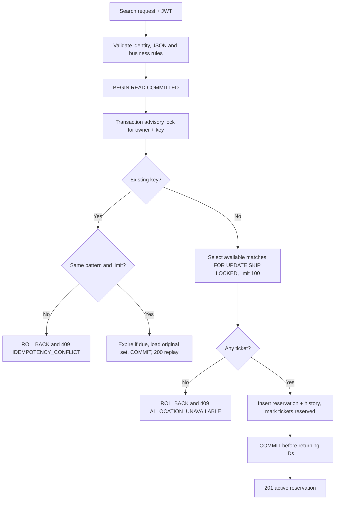
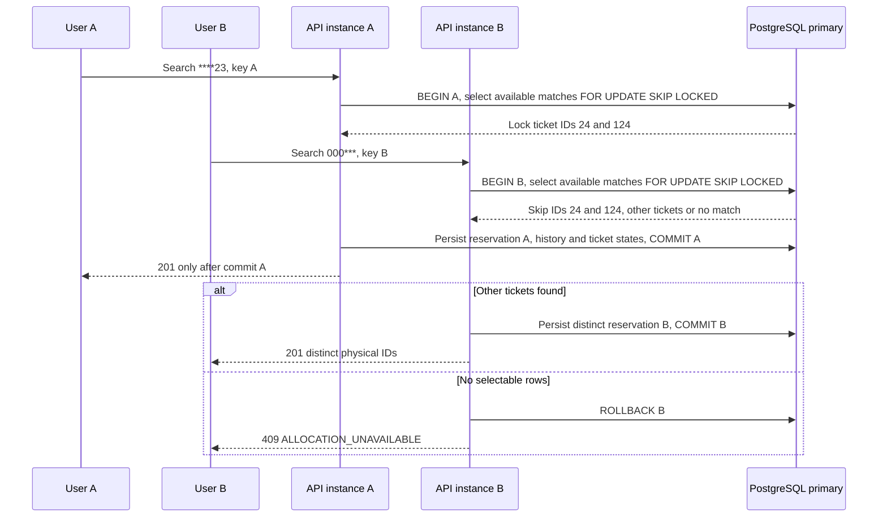
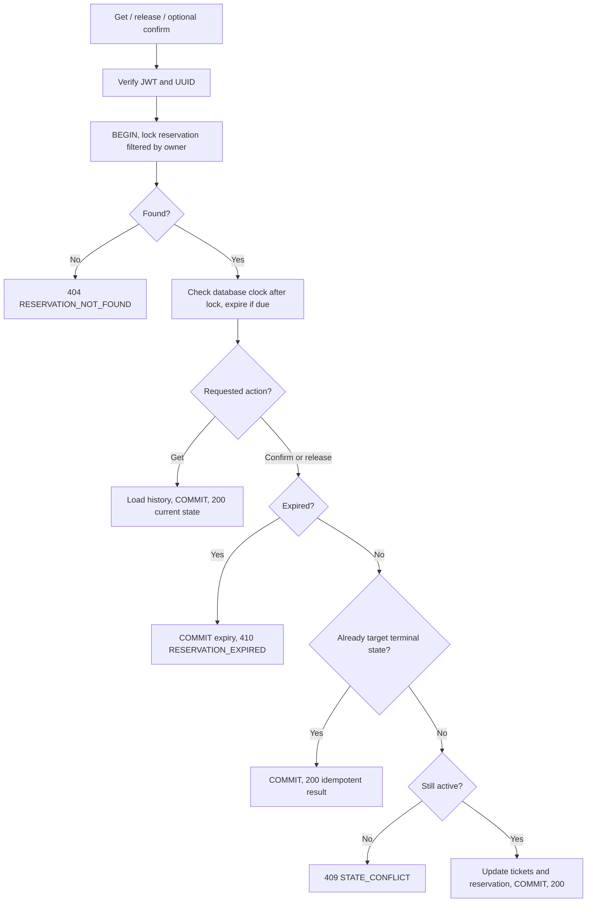
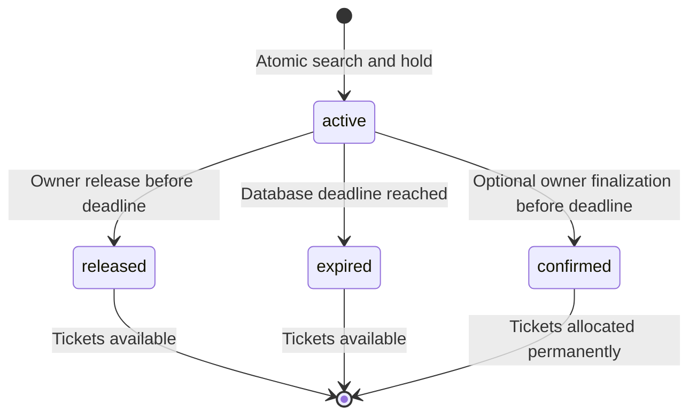
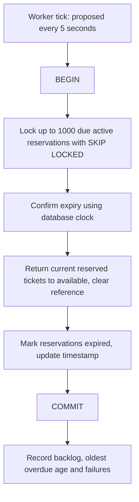

# ขั้นตอนค้นหา จอง และคืนสลาก

## สิ่งที่ต้องเป็นจริงเสมอ

1. สลากหนึ่งใบมีการจองปัจจุบันได้ไม่เกินหนึ่งรายการ
2. การจองที่ยัง active หรือยืนยันแล้วของคนละผู้ใช้ต้องไม่ถือ ticket_id เดียวกัน แม้ค้นหาคนละ pattern
3. จำนวน history ของการจองต้องเท่ากับ allocated_count และไม่เกิน requested_count
4. คำขอเดิมของผู้ใช้เดิมที่เคย commit แล้ว ต้องได้ reservation ID และชุดสลากเดิมเมื่อ retry ด้วย key เดิม
5. การจองที่ released/expired แล้วต้องไม่มีสิทธิ์ไปเปลี่ยนสลากที่ถูกจองใหม่

## 1. ค้นหาและสร้างการจอง

### ก่อนเปิด transaction

ตรวจ JWT และใช้ sub เป็น owner จากนั้นตรวจ body ไม่เกิน 4 KiB, pattern 6 ตัว, limit 1–100 และ key ไม่ว่าง/ไม่เกิน 128 UTF-8 bytes ปฏิเสธ unknown fields และ field ที่ซ้ำกันใน JSON

### ภายใน transaction

1. เปิด transaction โดยระบุ READ COMMITTED ให้ชัด ไม่พึ่งค่า default ของ server
2. ใช้ transaction advisory lock กับ owner/key เพื่อให้คำขอเดิมที่มาพร้อมกันรอกันก่อน
3. ตรวจว่ามี reservation ของ owner/key นี้แล้วหรือไม่ โดยล็อก reservation ที่พบด้วย FOR UPDATE
4. ถ้ามีและ pattern หรือ requested_count ไม่ตรง ให้ rollback และตอบ 409 IDEMPOTENCY_CONFLICT หากตรงให้ตรวจหมดอายุ โหลด history และ commit ก่อนตอบ 200
5. ถ้ายังไม่มี ให้เลือก available tickets ที่ตรง pattern ด้วย LIMIT ตามที่ขอ และ FOR UPDATE SKIP LOCKED
6. ถ้าไม่ได้สักใบ ให้ rollback และตอบ 409 ALLOCATION_UNAVAILABLE ไม่บันทึก reservation หรือ key ใหม่
7. ถ้าได้อย่างน้อยหนึ่งใบ ให้สร้าง reservation เปลี่ยน tickets เป็น reserved/current_reservation_id และเพิ่ม reservation_items ใน transaction เดียว
8. Commit ให้สำเร็จก่อนตอบ 201 และคืน ticket IDs

Advisory lock ต้องใช้ hash ที่คำนวณซ้ำแล้วได้ค่าเดิมจาก owner/key ให้เข้ารหัสทั้งสองค่าโดยระบุความยาวของแต่ละส่วนก่อน เช่นข้อมูลในรูปแบบ length-prefixed ห้ามต่อ string ตรง ๆ จน owner/key คนละชุดกลายเป็นข้อความเดียวกัน และไม่ใส่ NUL ลง PostgreSQL text

หาก hash ของคนละ key ชนกัน จะทำให้รอกันเพิ่ม แต่ยังใช้ owner/key จริงและ UNIQUE constraint ตัดสินว่าเป็นคำขอเดียวกันหรือไม่ ไม่ใช้ hash แทน identity ของคำขอ

### แปลง pattern เป็นเงื่อนไขอย่างไร

| Pattern | เงื่อนไขที่ต้องใช้ |
| --- | --- |
| ****23 | status=available AND d5=2 AND d6=3 |
| 1****5 | status=available AND d1=1 AND d6=5 |
| 000023 | status=available AND number='000023' |
| ****** | status=available โดยไม่เพิ่มเงื่อนไขตำแหน่ง |

ค่าที่มาจาก client ต้องส่งเป็น query parameters ส่วนชื่อ column เลือกได้เฉพาะ d1–d6 ที่ระบบกำหนดเอง ไม่รับชื่อ column หรือ SQL จาก client

## 2. เมื่อผู้ใช้ค้นหาพร้อมกัน

สมมติ A ล็อก ticket IDs 24 และ 124 ไว้ใน transaction เมื่อ B ค้นหาตรงกับสองใบนี้ด้วย SKIP LOCKED จะข้ามไปเลือกใบอื่น หลัง A commit สถานะสองใบเป็น reserved จึงไม่ผ่านเงื่อนไข available อีก

ล็อกแถวอยู่เฉพาะช่วงที่กำลังทำ transaction ส่วน hold 5 นาทีเป็นสถานะที่บันทึกไว้ ไม่ใช่การเปิด transaction ค้างไว้ 5 นาที

วิธีนี้อาจคืนผลน้อยกว่าที่มีจริงหรือได้ 409 ชั่วคราว ถ้าแถวที่ตรงคำค้นกำลังถูกล็อก จึงไม่ใช้ผลค้นหานี้สรุปจำนวนสลากว่างทั้งหมด หรือรับประกันลำดับผู้ได้สลาก

## 3. เปิดดู ยกเลิก และยืนยันการจอง

ทุกคำขอต้องค้นหาด้วย `id AND user_id` แล้วล็อก reservation ก่อน วิธีนี้ทำให้การจองของผู้อื่นตอบ 404 เหมือนหาไม่พบ และป้องกัน confirm/release เปลี่ยนสถานะพร้อมกัน

เมื่อได้ lock แล้วจึงตรวจ expires_at กับ clock_timestamp() ของ DB อย่าใช้เวลาเริ่ม transaction มาตัดสิน เพราะอาจรอ lock จนเลย deadline ไปแล้ว การตรวจผ่านก่อน deadline เป็นจุดตัดสินว่าอนุญาต แม้ commit จะตามมาหลัง deadline เล็กน้อย

ทุกขั้นตอนที่แตะ reservation เดิมให้ล็อก reservation **ก่อน** ticket ของมัน ส่วนการจองใหม่เลือก available tickets แล้วสร้าง reservation ใหม่ ซึ่งยังไม่มีคำขออื่นมาจัดการได้ ห้ามเพิ่มขั้นตอนที่ไปจับ reservation เก่าและจอง ticket ของ reservation อื่นต่อใน transaction เดียวโดยไม่ทบทวนลำดับ lock

ตอนคืนสลากให้ update เฉพาะ ticket ที่ current_reservation_id ตรงกับการจองนั้นและ status=reserved ตอน confirm ใช้ reference เดียวกันแล้วเปลี่ยนเป็น allocated อย่าใช้แค่ IDs จาก history เพราะใบเดิมอาจถูกคนอื่นจองใหม่แล้ว

## 4. สถานะของการจอง

confirmed เป็นตัวเลือกสำหรับปิดการจัดสรรอย่างถาวร ไม่ได้แปลว่ารับเงินแล้ว การจองที่ released/expired ไม่กลับมา active ด้วย key เดิม และ design นี้ยังไม่มีการต่อเวลา hold

## 5. Worker คืนสลากที่หมดเวลา

เริ่มจากตรวจทุก 5 วินาที ครั้งละไม่เกิน 1,000 reservations และจำกัดเวลา transaction ต่อชุด 3 วินาที ใช้ `expires_at <= statement_timestamp()` เลือกรายการที่น่าจะหมดอายุเพื่อให้ใช้ index ได้ จากนั้นตรวจเวลาจริงอีกครั้งหลังได้ lock

API get/confirm/release และการ retry key เดิมต้องตรวจหมดอายุด้วย วิธีนี้เรียกว่า lazy expiry คือจัดการรายการนั้นเมื่อมีคำขอมาใช้งาน ส่วน search ด้วย key ใหม่ไม่ต้องไล่คืน expired ทั้งตารางก่อนเริ่มจอง

หาก worker ทำงานช้า บางใบจะกลับมาว่างช้า แต่จะไม่แจกซ้ำ หลังพบว่าหมดเวลาแล้วต้อง commit การคืนสลาก/สถานะ expired ก่อนตอบ 410 ระวังการ return error ก่อน commit ซึ่งอาจทำให้ rollback สิ่งที่เพิ่งแก้ไป

## 6. เมื่อเกิดข้อผิดพลาด ควรทำอย่างไร

| เหตุการณ์ | สิ่งที่อาจเกิดใน DB | การทำงานที่ต้องการ |
| --- | --- | --- |
| input หรือ JWT ผิด | ยังไม่เปิด transaction | ตอบ 400/401 ให้ client แก้ข้อมูล |
| process หยุดก่อน commit | งานที่ยังไม่ commit จะ rollback เมื่อ connection ถูกจัดการ | retry ด้วย key เดิม; locks ถูกปล่อยเมื่อ transaction จบ |
| commit สำเร็จ แต่ response ส่งไม่ถึง | การจองและ key บันทึกแล้ว | retry key เดิมเพื่อรับ reservation เดิม ไม่จองเพิ่ม |
| connection ขาดระหว่าง commit | ยังไม่รู้ว่าสำเร็จหรือไม่ | ห้ามสรุปว่า rollback แล้ว ให้ retry key เดิม |
| confirm แข่งกับ release | reservation lock ทำให้ตรวจทีละคำขอ | สำเร็จได้สถานะสุดท้ายเพียงแบบเดียว อีก action ได้ 409 |
| confirm หลังหมดเวลาแข่งกับ worker | ทั้งคู่ตรวจเวลาภายใต้ reservation lock | ไม่ยอม confirm หลังจุดตัดสินหมดอายุ และคืนสลากอย่างสอดคล้องกัน |
| reservation เก่าพยายามคืนสลากหลังถูกจองใหม่ | ของเก่าสิ้นสุดแล้ว | ตอบ 410/409 และไม่แก้ current reservation ใหม่ |
| deadlock หรือรอ lock เกินเวลา | transaction ถูกยกเลิกหรือเกินเวลาที่กำหนด | ตอบ 503; server retry ทั้ง transaction ได้แบบจำกัดเมื่อรู้ว่า rollback แล้ว และยังอยู่ใน deadline |
| primary ล่ม | ขึ้นกับข้อมูลที่สำรองไว้และการตัดสิทธิ์ primary เก่า | หยุดรับจองชั่วคราว แล้วทำตามขั้นตอนกู้ระบบ ไม่ส่งต่อไป replica ทันที |

READ COMMITTED อย่างเดียวไม่พอ ต้องใช้ร่วมกับเงื่อนไข available, row locks, unique key, การตรวจ owner และการ commit ทุกข้อมูลพร้อมกัน
