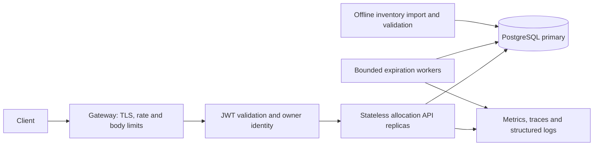

# โครงสร้างระบบและเหตุผลในการออกแบบ

## ภาพรวม

เมื่อมี request เข้ามา Gateway ตรวจขนาด body และจำกัดอัตราคำขอ จากนั้นตรวจ JWT เพื่อรู้ว่าใครเป็นผู้ใช้ แล้วส่งให้ Allocation API ค้นหาและจองผ่าน PostgreSQL

API เพิ่มจำนวน instances ได้ แต่ทุก instance ต้องใช้ฐานข้อมูลหลักเดียวกันในการตัดสินสิทธิ์ ส่วน Worker ทำหน้าที่คืนสลากที่หมดเวลาจอง โดยใช้กติกาการล็อกและ transaction แบบเดียวกับ API

## Separation of Responsibilities

| ส่วน | หน้าที่ |
| --- | --- |
| Handler | อ่าน JSON และเรียก use case จากนั้นแปลงผลเป็น HTTP response ตาม api.md |
| Service | ตรวจเงื่อนไขธุรกิจ เช่น pattern, limit, เจ้าของ และสถานะที่อนุญาต |
| Repository / transaction boundary | รัน query และจัดการ transaction โดยให้การตรวจที่ต้องอาศัย lock อยู่ใน transaction เดียวกับการเขียน |
| Worker | เรียกขั้นตอนหมดอายุทีละชุด ใช้ timeout และหยุดได้เมื่อระบบ shutdown |
| ระบบยืนยันตัวตน | ออก JWT; API นี้ตรวจ token และใช้ sub เป็นเจ้าของการจอง |

## ทำไมเลือก PostgreSQL

เราต้องเปลี่ยนหลายข้อมูลพร้อมกัน ได้แก่ สถานะสลาก เจ้าของการจอง key สำหรับ retry และประวัติ PostgreSQL ทำให้ข้อมูลเหล่านี้อยู่ภายใน commit เดียว พร้อม row locks และข้อจำกัด PK/FK

| ทางเลือก | จุดเด่น | สิ่งที่ต้องแลก |
| --- | --- | --- |
| PostgreSQL — เลือกใช้ | ทำ transaction, ล็อกแถว และเก็บประวัติในฐานข้อมูลเดียว | ต้องดูแล indexes, vacuum และกำลังเขียนของ primary |
| MongoDB | ทีมอาจคุ้นเคยจากข้อ 1; update เอกสารเดียวได้แบบ atomic | การจองหลายใบพร้อมประวัติหลายเอกสารยังต้องออกแบบ transaction และ indexes ให้ครบ |
| Redis bitmap/set | คัดกลุ่มเลขที่ตรง pattern ได้เร็วและใช้หน่วยความจำน้อย | ต้องออกแบบความคงทนของข้อมูลและการกู้คืน; ถ้าเก็บประวัติอีก DB จะมีปัญหาการเขียนสองที่ |
| Search engine หรือ read replica | เหมาะกับงานค้นหาและเพิ่มกำลังอ่าน | ผลค้นหาไม่ได้รับรองสิทธิ์จอง ยังต้องกลับมายืนยันกับแหล่งข้อมูลหลัก |

การเลือก PostgreSQL ทำให้ตรวจความถูกต้องได้จากจุดเดียว ไม่ได้แปลว่าเร็วที่สุดทุก workload ต้องวัดกับรูปแบบการใช้งานจริงตาม performance.md

## วิธีค้นหาที่เลือกเป็นจุดเริ่มต้น

เก็บเลขทั้ง 6 หลักใน number และให้ DB แยกเป็น d1–d6 อัตโนมัติ เช่น `000023` จะได้ d5=2 และ d6=3 คำค้น `****23` จึงใช้เงื่อนไข d5=2 AND d6=3 ได้

ทำ indexes ของแต่ละตำแหน่งเฉพาะสลากที่ available และมี index บน number สำหรับคำค้นแบบครบ 6 หลัก DB อาจเลือกใช้ index เดียว รวมหลาย index หรือ scan ตามความเหมาะสม ไม่ควรบังคับว่าทุก query ต้องใช้ index ทุกตัว

อีกทางเลือกคือ bitmap สำหรับแต่ละตำแหน่งและตัวเลข ที่หนึ่งล้านใบ bitmap หนึ่งชุดมีข้อมูลดิบประมาณ 125,000 bytes รวม 60 ชุดประมาณ 7.5 MB ก่อน overhead วิธีนี้น่าสนใจสำหรับคัด candidate แต่ยังต้องแก้เรื่องเลขซ้ำ การเปลี่ยนสถานะ และการเก็บสิทธิ์จองให้คงอยู่ จึงยังไม่เพิ่ม Redis จนกว่าจะวัดแล้วว่าจำเป็น

## ทำไม search ต้องจองทันที

ถ้าผู้ใช้ A และ B ได้สลากที่ยังไม่จองกลับไปก่อน ทั้งคู่อาจเลือกใบเดียวกัน เราจึงรวมขั้นตอนค้นหาและสร้าง hold เข้าด้วยกัน แล้วตอบ 201 หลัง commit สำเร็จเท่านั้น

เราล็อกแถวเฉพาะตอนทำ transaction ไม่ได้ล็อกฐานข้อมูลค้างไว้ 5 นาที หลัง commit ใช้สถานะ reserved ที่บันทึกไว้กันการจองซ้ำ

ใช้ SKIP LOCKED เพื่อข้ามแถวที่คำขออื่นกำลังใช้ จึงอาจได้สลากน้อยกว่า limit หรือได้ 409 ชั่วคราว แม้ยังมีเลขที่ตรง pattern อยู่ ข้อแลกเปลี่ยนนี้ระบุไว้ใน API แล้ว และไม่มีการรับประกันว่าใครมาก่อนจะได้ก่อน

## ตัวตนผู้ใช้และการยืนยัน

ใช้ JWT เพื่อรู้เจ้าของการจอง ไม่รับ user_id ใน body หากใช้ HS256 ร่วมกับข้อ 1 ต้องใช้ secret และ issuer ที่ตรงกัน แต่ผู้ที่ถือ secret จะสร้าง token ได้ด้วย ก่อนแยกเป็นบริการ production ควรทบทวนสิทธิ์ถือ key และแผนเปลี่ยน key

ถ้าต้องแยกผู้ลงนามออกจากผู้ตรวจ token สามารถพิจารณา asymmetric JWT ซึ่งให้ API ถือเฉพาะ verification key ส่วนการเพิกถอน token และผลเมื่อบัญชีถูกลบเป็นข้อตกลงกับระบบยืนยันตัวตน

Confirm เปลี่ยนสลากเป็น allocated เท่านั้น หากมีการรับเงินจริงภายหลัง ต้องออกแบบการเชื่อมต่อและการตรวจสอบยอดแยก ไม่ถือว่า confirm endpoint นี้จัดการเรื่องเงินให้แล้ว

## ควรกลับมาปรับ design เมื่อไร

- มีหลายงวด: เพิ่ม round_id ให้ครบทั้ง key, query และข้อจำกัด พร้อมวิธีปิดงวด
- มี pattern บางแบบถูกใช้บ่อย: วัดก่อนเพิ่ม composite index ให้รูปแบบนั้น
- Primary รับงานไม่ไหว: ตรวจ query, vacuum และ pool ก่อน แล้วจึงประเมิน partition/shard เพราะการจองข้าม shard จะไม่ใช่ transaction เดียวได้ง่าย ๆ
- ต้องเขียนหลายภูมิภาค: ออกแบบผู้มีสิทธิ์เขียนและความสอดคล้องของข้อมูลใหม่ ไม่ใช้ข้อสรุปจาก single primary ไปอ้างว่ารองรับแล้ว

แหล่งข้อมูลเรื่อง locks และ indexes อยู่ใน [references](references.md)
