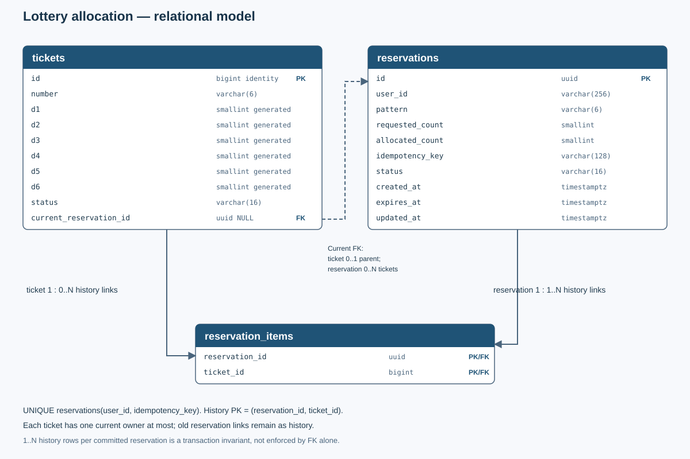
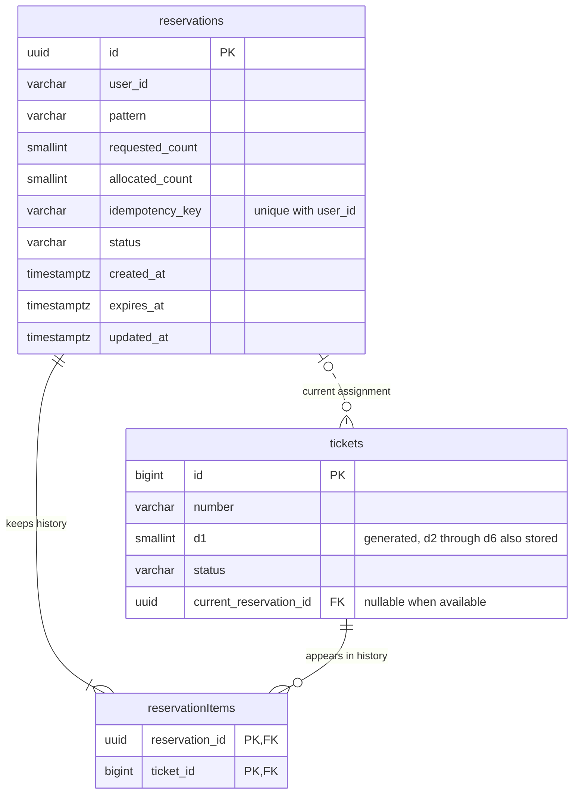

# ตารางฐานข้อมูลและความสัมพันธ์

ใช้ PostgreSQL และเริ่มจากข้อมูลสลากชุดเดียว มี 3 ตาราง:

| ตาราง | เก็บอะไร |
| --- | --- |
| tickets | สลากแต่ละใบ เลขสลาก และการจองปัจจุบันของใบนั้น |
| reservations | การจองแต่ละครั้ง เจ้าของ key สำหรับ retry และสถานะ |
| reservation_items | ประวัติว่าแต่ละการจองเคยได้สลากใบไหนบ้าง |

ไม่มี users table ในบริการนี้ user_id มาจากระบบยืนยันตัวตนภายนอก จึงไม่สร้าง FK ข้าม service และไม่เก็บ password หรือข้อมูลส่วนตัวอื่นนอกจาก subject ที่ใช้ระบุเจ้าของ

## DB diagram



Mermaid ด้านล่างเป็นข้อมูลความสัมพันธ์เดียวกัน ชื่อ reservationItems ในภาพหมายถึงตาราง reservation_items



การจองหนึ่งรายการที่ commit แล้วต้องมี history อย่างน้อยหนึ่งใบ สลากหนึ่งใบมี history ได้หลายครั้งเมื่อถูกคืนแล้วจองใหม่ แต่มี current reservation ได้มากที่สุดหนึ่งรายการ

FK ตรวจว่ารายการที่อ้างถึงมีอยู่ ไม่ได้ตรวจให้เองว่าการจองมี history อย่างน้อยหนึ่งใบ ต้องรักษากติกานี้ใน transaction ส่วนภาพ Mermaid ย่อ d1–d6 ไว้ที่ d1 ดู field ทั้งหกได้ในตารางต่อไป

## วิธีอ่าน data dictionary

- Mandatory: ต้องมีค่าหรือเป็นค่าที่ DB สร้างให้ ถ้ามีเงื่อนไขจะระบุไว้
- Nullable: column ยอมรับ NULL หรือไม่ เป็นคนละเรื่องกับ client ต้องส่งค่าหรือไม่
- PK: primary key ใช้ระบุ row ไม่ซ้ำ; FK: foreign key ใช้อ้างถึง row ของอีกตาราง
- Generated: ให้ DB คำนวณเอง ไม่รับค่าจาก API/importer
- timestamptz: เก็บเวลาเป็น instant; API แปลงเป็น UTC RFC 3339 ไม่ได้เก็บชื่อ timezone เดิมของผู้ส่ง

## 1. tickets

| Field | PostgreSQL type | Mandatory | Nullable | Key / default | Description |
| --- | --- | --- | --- | --- | --- |
| id | bigint identity | Yes, DB สร้าง | No | PK | ID ของสลากใบจริง API ส่งค่านี้เป็น string ใน ticket_id |
| number | varchar(6) | Yes | No | ไม่ unique | เลข ASCII 6 หลัก เก็บศูนย์นำหน้า ตรวจด้วย ^[0-9]{6}$; เลขซ้ำได้หากเป็นคนละใบ |
| d1 | smallint generated stored | Yes, DB สร้าง | No | คำนวณจาก number | เลขตำแหน่ง 1 มีค่า 0–9 |
| d2 | smallint generated stored | Yes, DB สร้าง | No | คำนวณจาก number | เลขตำแหน่ง 2 มีค่า 0–9 |
| d3 | smallint generated stored | Yes, DB สร้าง | No | คำนวณจาก number | เลขตำแหน่ง 3 มีค่า 0–9 |
| d4 | smallint generated stored | Yes, DB สร้าง | No | คำนวณจาก number | เลขตำแหน่ง 4 มีค่า 0–9 |
| d5 | smallint generated stored | Yes, DB สร้าง | No | คำนวณจาก number | เลขตำแหน่ง 5 มีค่า 0–9 |
| d6 | smallint generated stored | Yes, DB สร้าง | No | คำนวณจาก number | เลขตำแหน่ง 6 มีค่า 0–9 |
| status | varchar(16) | Yes | No | available | available=ว่าง, reserved=อยู่ใน hold, allocated=ยืนยันแล้ว ไม่ได้แปลว่าชำระเงิน |
| current_reservation_id | uuid | เมื่อ reserved/allocated | Yes | FK reservations.id | NULL เมื่อ available; ต้องมีค่าในอีกสองสถานะ ลบ parent ที่ถูกอ้างถึงไม่ได้: ON DELETE RESTRICT |

ให้ DB สร้างแต่ละ di ด้วย `substring(number, i, 1)::smallint` เช่น number=000023 จะได้ d1..d4=0, d5=2, d6=3 ห้ามแก้ number หลังเปิดรับจอง เพราะจะทำให้สลากที่ผู้ใช้เลือกเปลี่ยนความหมาย

## 2. reservations

| Field | PostgreSQL type | Mandatory | Nullable | Key / default | Description |
| --- | --- | --- | --- | --- | --- |
| id | uuid | Yes, application สร้าง | No | PK | ID ของการจองใหม่ สร้างเมื่อเลือกสลากได้อย่างน้อยหนึ่งใบ |
| user_id | varchar(256) | Yes | No | JWT subject | เจ้าของจาก JWT ต้องไม่ว่าง/มี NUL และไม่เกิน 256 UTF-8 bytes ไม่รับผ่าน business body |
| pattern | varchar(6) | Yes | No | ไม่แก้ภายหลัง | pattern เดิม 6 ตัวเลข/* ตรวจด้วย ^[0-9*]{6}$ |
| requested_count | smallint | Yes | No | ไม่แก้ภายหลัง | limit ที่ client ขอครั้งแรก มีค่า 1–100 |
| allocated_count | smallint | Yes | No | ไม่แก้ภายหลัง | จำนวนใบที่ได้ตอนสร้างการจอง ต้องอยู่ใน 1..requested_count และเท่าจำนวน history แม้ภายหลังคืนสลากแล้ว |
| idempotency_key | varchar(128) | Yes | No | UNIQUE(user_id,idempotency_key) | key เดิมใช้กู้ผลเดิม ไม่ว่าง/มีแต่ช่องว่าง/มี NUL และไม่เกิน 128 UTF-8 bytes เทียบแบบแยกตัวใหญ่เล็ก ไม่ trim ค่า |
| status | varchar(16) | Yes | No | active | active, confirmed, released หรือ expired |
| created_at | timestamptz | Yes, DB สร้าง | No | เวลาจาก DB | เวลาสร้าง ไม่ใช้เวลาที่ client ส่งมา |
| expires_at | timestamptz | Yes, DB สร้าง | No | created_at + hold TTL | เวลาสิ้นสุด hold ต้องหลัง created_at ไม่ทำให้ confirmed หมดอายุ |
| updated_at | timestamptz | Yes, DB สร้าง | No | เวลาจาก DB | เวลาเปลี่ยนสถานะล่าสุด ไม่เปลี่ยนเมื่อ retry แล้วไม่ได้แก้ state |

varchar จำกัดจำนวนตัวอักษร ไม่ได้แทนข้อจำกัด UTF-8 bytes ให้ตรวจ octet_length เพิ่มตามที่กำหนดด้วย

## 3. reservation_items

| Field | PostgreSQL type | Mandatory | Nullable | Key | Description |
| --- | --- | --- | --- | --- | --- |
| reservation_id | uuid | Yes | No | ส่วนของ PK; FK reservations.id | การจองที่เป็นเจ้าของ history row; ON DELETE RESTRICT |
| ticket_id | bigint | Yes | No | ส่วนของ PK; FK tickets.id | สลากที่เคยอยู่ในการจองนี้; ON DELETE RESTRICT |

ใช้ PK แบบคู่ (reservation_id,ticket_id) เพื่อไม่ให้ใบเดียวกันซ้ำภายในการจองเดียว แต่ห้ามทำ UNIQUE(ticket_id) ทั้งตาราง เพราะใบเดิมต้องมี history หลายครั้งได้เมื่อถูกคืนแล้วจองใหม่

## ข้อจำกัดที่ต้องใส่และสิ่งที่ transaction ต้องดูแล

| เงื่อนไข | ให้ส่วนไหนตรวจ |
| --- | --- |
| id ไม่ซ้ำ และ row ที่อ้างถึงมีอยู่ | PK/FK; ใช้ RESTRICT ไม่ลบ parent ที่ยังถูกอ้างถึง |
| number/pattern ยาวและมีตัวอักษรถูกต้อง | type และ CHECK |
| requested_count อยู่ใน 1..100; allocated_count อยู่ใน 1..requested_count; expires_at หลัง created_at | CHECK ของ reservations |
| available ต้อง current_reservation_id=NULL; reserved/allocated ต้องมี reference | CHECK ของ tickets |
| active ถือ reserved; confirmed ถือ allocated; released/expired ไม่ถือ ticket ปัจจุบัน | transaction ที่ update หลายตาราง และงานตรวจข้อมูลเป็นระยะ |
| allocated_count ตรงจำนวน reservation_items | transaction; FK อย่างเดียวไม่ตรวจจำนวนให้ |

PK/FK ไม่ควรถูกแก้เป็น ID ใหม่ ทุกทางที่จอง ยืนยัน ยกเลิก หรือหมดอายุต้องเขียนข้อมูลที่เกี่ยวข้องใน commit เดียว ห้าม update ตรงโดยข้ามกติกาแล้วคาดว่า CHECK จะตรวจความสัมพันธ์ข้ามทุกตารางให้เอง

## Indexes ที่เสนอ

| Index | Keys / เงื่อนไข | ใช้ทำอะไร | สิ่งที่ต้องระวัง |
| --- | --- | --- | --- |
| tickets PK | id | หาและ update สลากตาม physical ID | มีทุกใบ |
| tickets_available_number | number WHERE status='available' | ค้นเลขครบ 6 หลัก | index เปลี่ยนเมื่อจอง/คืน |
| tickets_available_id | id WHERE status='available' | เลือกสลากสำหรับ pattern กว้าง | DB อาจเลือก scan เมื่อ match มาก |
| tickets_available_d1..d6 | di WHERE status='available' รวม 6 indexes | ค้นตำแหน่งที่เป็นตัวเลข และอาจรวมหลาย index | แต่ละตำแหน่งมีแค่ 10 ค่า จึงยังอ่านข้อมูลมากและมีค่าเขียน/vacuum |
| tickets_current_reservation | current_reservation_id WHERE current_reservation_id IS NOT NULL | หา tickets ของการจองเพื่อเปลี่ยนสถานะ | FK ไม่ได้สร้าง index ด้านที่อ้างถึงให้เอง |
| reservations_owner_key | UNIQUE(user_id,idempotency_key) | หาคำขอเดิมและกัน key ซ้ำของ owner เดิม | เก็บตลอดอายุข้อมูลชุดนี้ |
| reservations_active_expiry | expires_at WHERE status='active' | เลือก hold ที่หมดเวลา | ไม่ใช้ now() ในเงื่อนไขสร้าง index; ใส่เวลาตัดสินใน query |
| reservation_items PK | reservation_id,ticket_id | โหลดประวัติของการจอง | ถ้าต้อง audit ตาม ticket บ่อย ค่อยวัดก่อนเพิ่ม index อีกด้าน |

ตัวอย่าง SQL ประกอบการออกแบบ ยังไม่ใช่ migration ที่ deploy แล้ว:

```sql
CREATE INDEX tickets_available_d6 ON tickets(d6) WHERE status = 'available';
CREATE INDEX reservations_active_expiry ON reservations(expires_at) WHERE status = 'active';
SELECT id, number FROM tickets
WHERE status = 'available' AND d5 = $1 AND d6 = $2
LIMIT $3 FOR UPDATE SKIP LOCKED;
```

ตัวอย่าง query นี้ใช้กับ ****23 โดยส่ง parameters เป็น 2, 3 และ limit ส่วน 1****5 ใช้ d1=1 AND d6=5 เลขครบใช้ number=$1 และ ****** ไม่ต้องเพิ่มเงื่อนไข digit ชื่อ column ต้องมาจาก d1–d6 ที่ระบบเลือกเอง ไม่รับจาก client

## ตัวอย่างข้อมูลที่อยู่ใน DB

ดูครบทั้งสามตารางที่ [database-snapshot.json](../examples/database-snapshot.json) ตัวอย่างกำหนดเวลาไว้ที่ 2026-11-02T10:01:00Z มี active reservation หนึ่งรายการ reserved tickets สองใบ และ available อีกหนึ่งใบ

snapshot_at ในไฟล์เป็นเวลาอ้างอิงของตัวอย่าง ไม่ใช่ column ของตาราง ส่วนแต่ละ array แทนข้อมูลในตารางชื่อนั้น ตัวอย่าง ticket หนึ่ง row:

```json
{"id":24,"number":"000023","d1":0,"d2":0,"d3":0,"d4":0,"d5":2,"d6":3,"status":"reserved","current_reservation_id":"ecad59f1-a023-40c1-9213-ef7f7cf396a0"}
```

เมื่อ release/expire ให้คืน ticket เป็น available/current_reservation_id=NULL และเปลี่ยนสถานะ/updated_at ของ reservation โดยไม่ลบ history เมื่อ confirm ให้ ticket เป็น allocated และ reservation เป็น confirmed โดยคง reference เดิม

## นำเข้า ตรวจความถูกต้อง และเปลี่ยน schema

นำเข้าทีละ batch ก่อนเปิดรับจอง ใช้ streaming COPY เพื่อไม่เก็บทั้งชุดใน memory ตรวจจำนวน เลข 6 หลัก และแหล่งที่มา จากนั้น ANALYZE ให้ DB มีสถิติสำหรับเลือก query plan

เก็บหลักฐานระบุ batch ที่นำเข้าแล้วเพื่อป้องกันนำชุดเดิมซ้ำ การมี sequence ID ไม่ได้กันนำข้อมูลซ้ำ และห้าม truncate inventory ที่กำลังเปิดจอง

งานตรวจข้อมูลให้เริ่มอ่านอย่างเดียว เปรียบเทียบ ticket state, current reservation และจำนวน history ก่อนแจ้งเตือนหรือซ่อมผ่านขั้นตอนที่ review แล้ว ไม่คืนสลากเองจากข้อมูลไม่ครบ

Migration ภายหลังต้องมี version ใช้วิธีเพิ่มของใหม่ เติมข้อมูล ตรวจ แล้วเลิกใช้ของเก่า ไม่ให้ API ทุก instance รัน DDL ที่ล็อกงานอื่นระหว่าง startup
